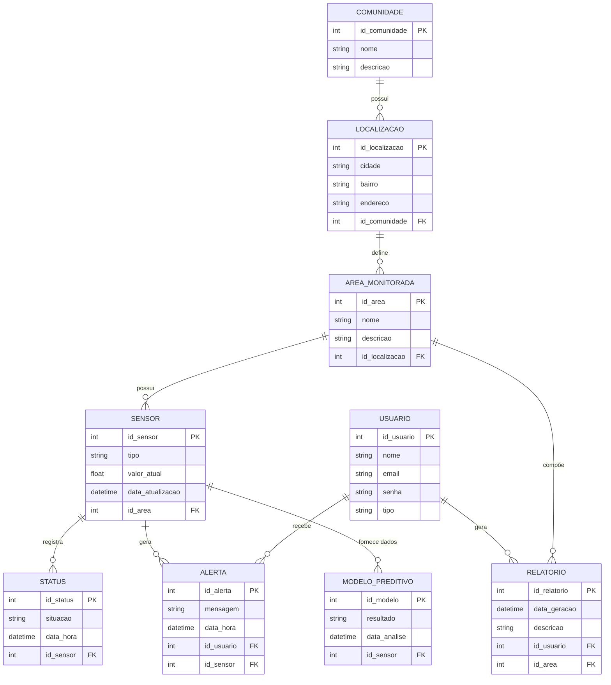

# 🗄️ Diagrama MER — Banco de Dados

Este diagrama representa a estrutura do banco de dados do sistema, apresentando
as entidades, seus principais atributos, chaves primárias (PK), chaves
estrangeiras (FK) e os relacionamentos existentes entre elas.

